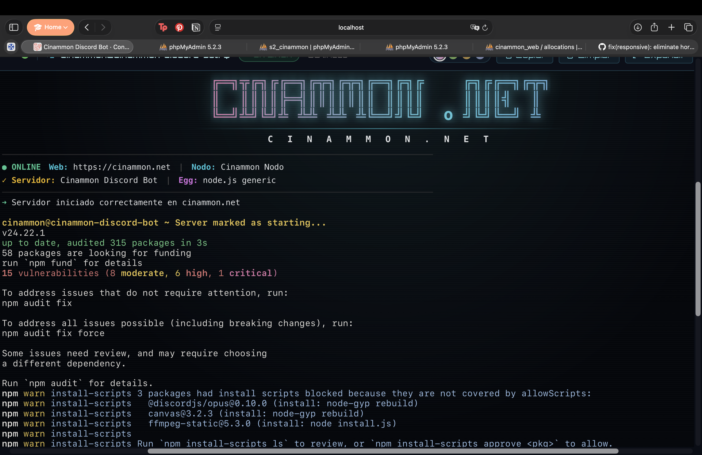
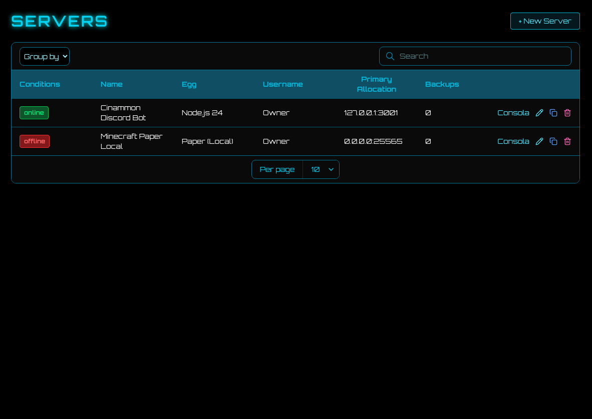
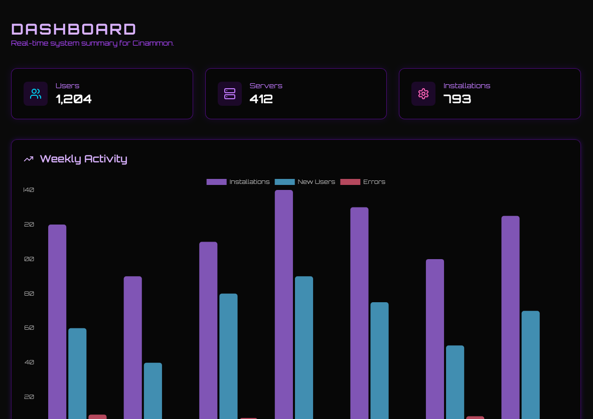
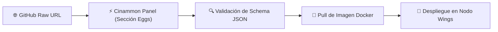

<p align="center">
  <pre align="center">
<font color="#10b981"><b>╔═╗╔═╗╔═╗╔═╗  ╔═╗╦  ╔═╗╔═╗╦ ╦╦╔═╗</b></font>
<font color="#00f7ff"><b>║╣ ║ ╦║ ╦╚═╗  ╠═╝║  ║ ╦╠═╝╠═╣║╠═╝</b></font>
<font color="#a855f7"><b>╚═╝╚═╝╚═╝╚═╝  ╩  ╩═╝╚═╝╩  ╩ ╩╩╩  </b></font>
  </pre>
  <p align="center">
    <b><code>// OFFICIAL CYBERNETIC BLUEPRINTS & DOCKER RUNTIME MATRIX //</code></b>
  </p>
  <p align="center">
    <a href="https://github.com/cinammon-net/eggs"></a>
    <a href="https://github.com/cinammon-net/eggs"></a>
    <a href="https://github.com/cinammon-net/eggs"></a>
    <a href="https://github.com/cinammon-net/panel"></a>
  </p>
</p>

---

## ⚡ // 01. RUNTIME VISUALS & DEPLOYMENTS

<div align="center">
  <p><b>🎮 INSTANT EGG DEPLOYMENT & CONSOLE EXECUTION</b></p>
  
  <p><i>Ejecución aislada y estandarizada en contenedores Docker mediante scripts de inicialización limpios y verificados.</i></p>
</div>

<br />

<div align="center">
  <table width="100%">
    <tr>
      <td width="50%" align="center">
        <b>🚀 CLOUD RUNTIMES & GAMES FLEET</b><br /><br />
        <br />
        <sub>Despliegue multi-instancia de Minecraft, Rust, Palworld, Node.js y bases de datos con un clic.</sub>
      </td>
      <td width="50%" align="center">
        <b>📦 ZERO-TOUCH REPRODUCIBILITY</b><br /><br />
        <br />
        <sub>Definiciones inmutables de variables de entorno, puertos de red y volúmenes persistentes.</sub>
      </td>
    </tr>
  </table>
</div>

---

## 📂 // 02. CURATED CATEGORY MATRIX

Colección oficial de más de **129 plantillas de servidores**, curadas y optimizadas para rendimiento, seguridad y compatibilidad directa con [Cinammon Panel](https://github.com/cinammon-net/panel) y [Cinammon Wings](https://github.com/cinammon-net/wings).

| Categoría | Protocolo / Descripción | Cantidad | Stack Soportado |
| :--- | :--- | :---: | :--- |
| **[`minecraft/`](./minecraft)** | Servidores Minecraft Java, Bedrock, proxies de red y modded | `32 eggs` | Paper, Fabric, Forge, NeoForge, Folia, Purpur, Velocity, BungeeCord, Bedrock |
| **[`games/`](./games)** | Servidores dedicados para multijugador masivo | `57 eggs` | Palworld, Rust, CS2, ARK: Survival Evolved, 7 Days to Die, Valheim, FiveM, GTA, Unturned |
| **[`bots/`](./bots)** | Automatizaciones, bots de Discord, Twitch y Teamspeak | `13 eggs` | Discord.js, Discord.py, JMusicBot, RedBot, Ree6, Sinusbot, Dynamica |
| **[`database/`](./database)** | Motores de bases de datos relacionales y de clave-valor | `11 eggs` | Redis, MariaDB, MySQL, PostgreSQL, MongoDB, RethinkDB |
| **[`generic/`](./generic)** | Entornos de ejecución limpios para desarrolladores | `10 eggs` | Node.js (v18-v24), Bun, Python 3, Golang, Rust, Deno |
| **[`software/`](./software)** | Paneles web, analítica, monitorización y almacenamiento | `14 eggs` | Uptime Kuma, Code-Server, Meilisearch, MinIO S3, Gitea, Grafana, Prometheus |
| **[`voice/`](./voice)** | Servidores de transmisión de voz y audio de baja latencia | `6 eggs` | Lavalink, Teamspeak 3 (ARM64/x86), TeaSpeak, TS3 Manager |

---

## 🛰️ // 03. ONE-CLICK IMPORT PIPELINE



### Pasos de Instalación en el Panel

1. Navega a tu panel de Cinammon en la sección de administración **Eggs** (`/admin/eggs` o menú Eggs).
2. Haz clic en el botón superior **Importar Egg** (*Import Egg*).
3. Pega la URL directa (`Raw`) de la plantilla JSON deseada de este repositorio:
   ```text
   https://raw.githubusercontent.com/cinammon-net/eggs/main/{categoria}/{archivo}.json
   ```
4. *Ejemplo para Paper Minecraft:*
   ```text
   https://raw.githubusercontent.com/cinammon-net/eggs/main/minecraft/paper.json
   ```
5. Pulsa **Guardar**: el egg validará los scripts de instalación, variables de arranque y quedará disponible para crear nuevos servidores en segundos.

---

## 🔮 // 04. ANATOMY OF A CYBER EGG

Cada archivo JSON contiene una especificación inmutable:

```json
{
  "_comment": "DO NOT EDIT: FILE GENERATED AUTOMATICALLY BY CINAMMON",
  "meta": {
    "version": "PTDL_v2",
    "update_url": null
  },
  "exported_at": "2026-11-01T00:00:00Z",
  "name": "Paper Minecraft",
  "author": "support@cinammon.net",
  "description": "High performance Minecraft server software aiming to fix gameplay and mechanics inconsistencies.",
  "features": ["eula", "java_version"],
  "docker_images": {
    "Java 21": "ghcr.io/cinammon-net/yolks:java_21",
    "Java 25": "ghcr.io/cinammon-net/yolks:java_25"
  },
  "startup": "java -Xms128M -XX:MaxRAMPercentage=95.0 -jar {{SERVER_JARFILE}}",
  "config": {
    "files": "{\r\n    \"server.properties\": {\r\n        \"parser\": \"properties\",\r\n        \"find\": {\r\n            \"server-ip\": \"0.0.0.0\",\r\n            \"server-port\": \"{{server.build.default.port}}\"\r\n        }\r\n    }\r\n}",
    "startup": "{\r\n    \"done\": \")! For help, type \"\r\n}"
  }
}
```

---

## 📡 // 05. ECOSYSTEM MATRIX

| Repositorio | Función | Stack Tecnológico |
| :--- | :--- | :--- |
| **[cinammon-net/eggs](https://github.com/cinammon-net/eggs)** | Catálogo de más de 129 plantillas de instalación y ejecución | Dockerfiles, Bash Scripts, JSON Blueprints |
| **[cinammon-net/panel](https://github.com/cinammon-net/panel)** | Orquestador principal, interfaz de administración y consola cyber | Laravel 11, React 18, Inertia.js, TailwindCSS |
| **[cinammon-net/billing](https://github.com/cinammon-net/billing)** | Portal de clientes, tienda de planes automatizada y pasarelas | Laravel 11, Inertia.js, TailwindCSS, Fortify 2FA |
| **[cinammon-net/wings](https://github.com/cinammon-net/wings)** | Daemon de alto rendimiento, comunicación WebSocket y SFTP | Golang 1.23, Docker Engine API, WebSockets |

---

<p align="center">
  <sub>Cinammon.net // Curated Blueprint Infrastructure // 2026</sub>
</p>
